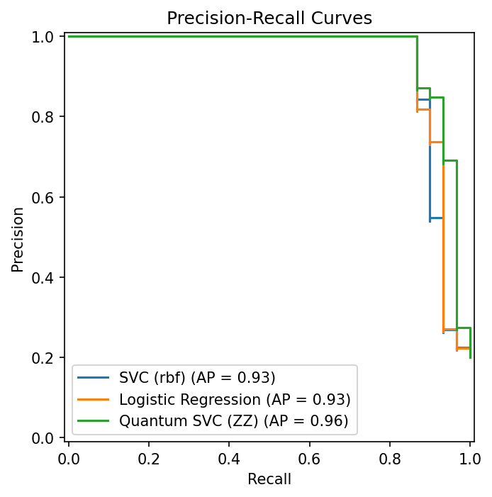
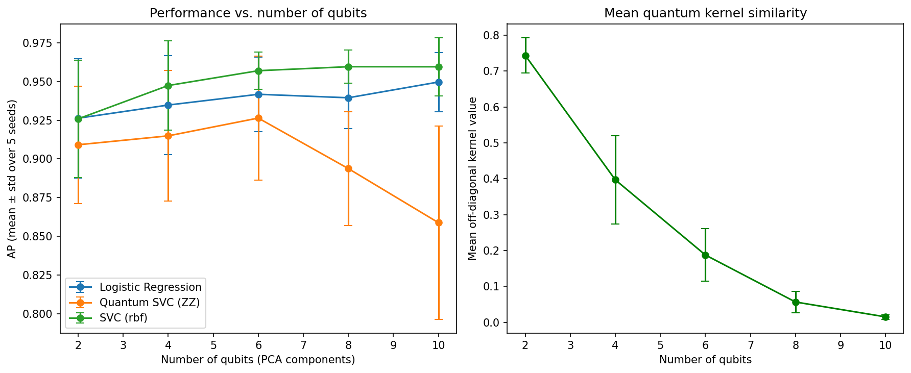

# Quantum Kernel SVM for Credit Card Fraud Detection

A quantum-kernel support vector machine (Qiskit) is compared with classical baselines on a real fraud-detection dataset. The study also looks at how the quantum kernel behaves as the number of qubits grows.

**Main finding:** in this setup, the quantum kernel is competitive at small qubit counts but does not outperform the classical baselines on average. At higher qubit counts, the mean similarity in the quantum kernel decreases and the quantum model's performance drops, while the classical baselines keep improving.

## Motivation

Fraud detection is a highly imbalanced classification problem where missed frauds are costly.
Quantum kernel methods encode data into quantum states and measure similarity through state overlap, which may capture structure that classical kernels miss.
This project compares that approach with standard classical baselines on the same data.

## Data

- **Source:** [Credit Card Fraud Detection](https://www.openml.org/d/1597) (OpenML ID 1597), 284,807 transactions, of which 492 are fraud (0.17%)
- **Features:** 28 anonymized PCA components (`V1`–`V28`) plus `Amount`
- **Subsample:** 100 fraud + 400 normal transactions (20% fraud), so the quantum kernel stays tractable to simulate
- **Split:** 70/30 stratified train/test split (350 / 150 samples, with 70 / 30 frauds)

## Method

| Step | Details |
|---|---|
| Preprocessing | Standardize → PCA to *n* components → min-max scale to [0, π]. All transforms are fit on the training set only, to avoid leakage (so test values can fall slightly outside [0, π]) |
| Quantum feature map | `zz_feature_map`: one qubit per feature, `reps=2`, linear entanglement |
| Quantum kernel | Fidelity kernel K(x, x′) = \|⟨φ(x)\|φ(x′)⟩\|², computed with `FidelityStatevectorKernel` |
| Quantum classifier | `SVC(kernel='precomputed', class_weight='balanced')` |
| Classical baselines | SVC with RBF kernel and Logistic Regression, on the same features with `class_weight='balanced'` |
| Main metric | Average precision (AP, `average_precision_score`), a summary of the precision–recall curve. Accuracy is misleading on imbalanced data; recall and precision are also reported |

## Results

### Main experiment (4 qubits, seed 42)

| Model | Recall | Precision | AP |
|---|---|---|---|
| SVC (RBF) | 0.867 | 0.963 | 0.930 |
| Logistic Regression | 0.867 | 0.963 | 0.935 |
| Quantum SVC (ZZ) | 0.867 | 0.963 | 0.956 |



All three models detect 26 of the 30 test frauds, with one false alarm. They differ only in how they rank the last few hard-to-detect frauds; on this split, the quantum kernel ranks them slightly better.

### Robustness: 5 seeds × 2–10 qubits

To check whether the single-run result holds, the full pipeline (subsampling, split, preprocessing and all three models) was repeated with 5 other random seeds (0–4) for each qubit count. The number of qubits equals the number of PCA components.

AP (mean ± std over 5 seeds):

| Qubits | SVC (RBF) | Logistic Regression | Quantum SVC (ZZ) |
|---|---|---|---|
| 2 | 0.926 ± 0.038 | 0.926 ± 0.039 | 0.909 ± 0.038 |
| 4 | 0.947 ± 0.029 | 0.935 ± 0.032 | 0.915 ± 0.042 |
| 6 | 0.957 ± 0.012 | 0.942 ± 0.024 | 0.926 ± 0.040 |
| 8 | 0.960 ± 0.011 | 0.939 ± 0.020 | 0.894 ± 0.037 |
| 10 | 0.960 ± 0.019 | 0.950 ± 0.019 | 0.859 ± 0.062 |



**Key observations**

1. **The seed-42 advantage was not reproduced.** Averaged over the five other seeds, the quantum kernel is slightly below the classical baselines at 4 qubits (0.915 vs. 0.935–0.947).
2. **The classical baselines improve with more components; the quantum model does not.** The classical models gain as more PCA components are kept (SVC: 0.926 → 0.960). The quantum model peaks at 6 qubits (0.926), then drops to 0.859 at 10 qubits, with larger variation across seeds.
3. **The mean kernel similarity decreases with qubit count.** The mean off-diagonal value of the training kernel matrix falls from 0.743 at 2 qubits to 0.397 (4), 0.188 (6), 0.057 (8) and 0.015 at 10 qubits.
4. **Quantum recall drops at 10 qubits.** The quantum model's mean recall falls to 0.287 (range 0.13–0.63 across seeds), compared with about 0.81–0.84 for the classical baselines.

## Discussion

A plausible explanation is the *exponential concentration* of fidelity kernels reported in the quantum machine learning literature. With *n* qubits, the feature map embeds each sample into a 2ⁿ-dimensional Hilbert space; as *n* grows, encoded states tend to become less similar, which leaves an SVM with less similarity information to learn from. The falling mean kernel value is consistent with this, but this study does not prove it:

- only the mean off-diagonal value was measured, not the full distribution of kernel values;
- the number of qubits and the number of PCA components change together, so the effect of the larger Hilbert space is not separated from the effect of the extra input features.

The linear baseline (Logistic Regression) is competitive with the RBF SVM throughout, which suggests there is limited room for non-linear kernels to add value on these features.

## Limitations

- **Not the real fraud rate.** Training and test sets contain 20% fraud, compared with 0.17% in the full dataset. The reported precision and AP describe this rebalanced benchmark, not performance on real transaction streams; `class_weight='balanced'` does not remove this limitation. An operational evaluation would need a test set with the true fraud prevalence.
- **Small evaluation sets.** Each test split has only 30 frauds, so the uncertainty in all metrics is large, and differences between models have not been tested statistically.
- **Qubit count and PCA dimension are confounded** (see Discussion).
- **Noiseless statevector simulation.** On real hardware, gate noise and finite measurement shots would make small kernel values harder to estimate.
- A single feature-map design was tested, with default hyperparameters.

## How to run

**In Google Colab:** open `quantum_kernel_fraud.ipynb` (File → Open notebook → GitHub tab, then paste this repository's URL) and run all cells. The data is downloaded automatically from OpenML.

**Locally:**

```bash
pip install -r requirements.txt jupyter
jupyter notebook quantum_kernel_fraud.ipynb
```

Tested with Python 3.13, Qiskit 2.6.2 and qiskit-machine-learning 0.9.1.

## Files

| File | Description |
|---|---|
| `quantum_kernel_fraud.ipynb` | Full notebook: data, preprocessing, models and experiments |
| `pr_curves_4q_42.png` | Precision-recall curves for the main experiment |
| `quantum_kernel_results.png` | AP and mean kernel similarity vs. number of qubits |
| `quantum_kernel_results.csv` | Raw results for all 25 runs (5 seeds × 5 qubit counts); the `PR-AUC` column holds average precision |
| `requirements.txt` | Package versions |
